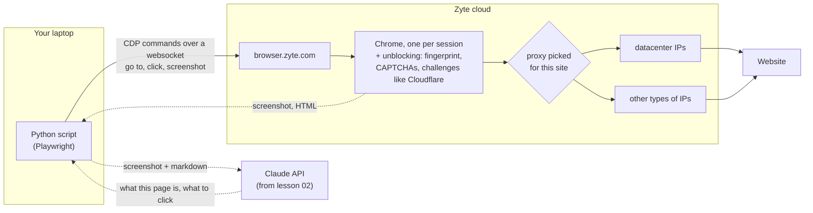
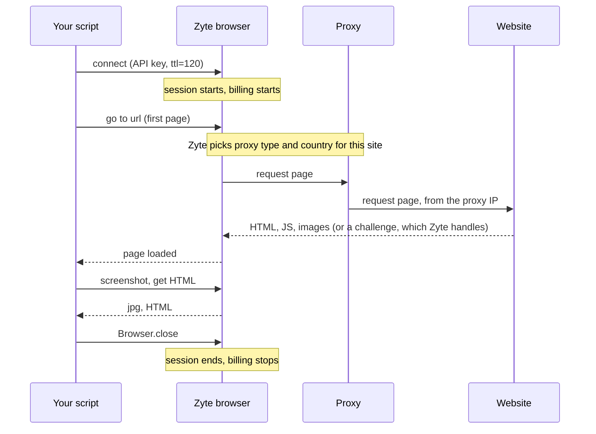

# 01 First session

Goal: understand what's actually going on when your code "opens a browser" on Zyte. Then run one session and look at what comes back.

No coding in this lesson. You run a script and read the output.

## The mental model

The browser is not on your laptop. It runs in Zyte's cloud, behind a proxy Zyte picks for the site you're visiting. Your script only sends it commands and gets results back.



Four parts, four jobs:

- **Zyte browser** loads the page. Real Chrome that runs the JavaScript. Zyte takes care of what makes a browser look like a bot (fingerprint, TLS) and handles CAPTCHAs and challenge pages like Cloudflare's.
- **Proxy** is where the site thinks you are. Zyte picks it on the first page you open: datacenter or residential, and a country, whatever works best for that site. You can force it with `proxy_type` and `proxy_region` on the connect URL. One session keeps one IP and one cookie jar until it ends.
- **Your script** is the middle. It tells the browser what to do and collects what it sees.
- **Claude** (from lesson 02) never touches the browser. It only gets what your script sends it and answers with a decision.

CDP (Chrome DevTools Protocol) is the same protocol Chrome DevTools uses. Playwright speaks it, so `connect_over_cdp` gives you a normal Playwright `page`, just running somewhere else.

## One session, start to end



Things to remember:

- **The first page decides the proxy.** The site you open first is the one Zyte picks the proxy and country for. Every page after that in the same session goes through the same IP.
- **Close the session.** Playwright's `browser.close()` only disconnects your script. The browser on Zyte's side keeps running until `ttl`. That's why `shared/zyte_cdp.py` sends `Browser.close` over CDP when your script ends, even on a crash.
- **`ttl` is the safety net.** If everything goes wrong, the session dies after `ttl` seconds anyway.
- **What it costs.** A session costs whichever is higher: the number of `page.goto()` calls, or the session length in 15 second blocks. One quick page is one unit, same price as a single browser request.

## Run it

```bash
python lessons/01-first-session/first_session.py
```

It opens [quotes.toscrape.com/js](https://quotes.toscrape.com/js/), a page that only shows its content after JavaScript runs. Every step prints what it does, the time since start, and the CDP messages it caused:

- `► Method` is a command your script sent to the browser
- `◀ Method` is a reply or an event the browser sent back

The full trace, every single message, is in `output/01/cdp_trace.log`.

## What to look at

**1. Connect.** `Browser.getVersion` comes back first. That's the Chrome running for you at Zyte. Look at the user agent: it's not your laptop. Then Playwright opens a tab (`Target.createTarget`) and turns on the events it needs (`Page.enable`, `Network.enable`, ...).

**2. Go to the page.** One command, `Page.navigate`. Everything after it is the browser telling you what it does: the page request, then CSS, JS and fonts it pulls in on its own. Your laptop never talks to the website.

**3. Wait.** `load` fired, but pages keep fetching after that. We wait until the network goes quiet (max 5s).

**4. Screenshot.** `Page.captureScreenshot` comes back as base64 inside the CDP message. Note the size, it's what we'll send to Claude in lesson 02.

**5. HTML to markdown.** No special CDP command for this. Playwright runs a bit of JavaScript in the page (`Runtime.callFunctionOn`) and gets the HTML back. Then we strip scripts and styles and convert to markdown. Compare the two sizes: markdown is what the model reads, and you pay per token.

**6. What can be clicked.** Same trick, our own JS runs in the page and lists visible links and buttons. Numbered, so in lesson 03 Claude can answer "click 3" instead of guessing selectors.

**7. Which IP did the site see.** A new tab in the same session opens ipinfo.io. Same session, so same proxy as the page you just loaded. Look at the network name: a hosting company (M247, Latitude.sh, OVH) means a datacenter proxy, a home ISP (Comcast, Virgin Media, Vodafone) means residential. This costs one extra page load.

**8. Close.** `Browser.close`. Session over, billing stops.

Then open the files in `output/01/`:

| File | What it is |
|---|---|
| `screenshot.jpg` | what the browser saw |
| `page.md` | the page as text, what the model reads |
| `links.txt` | numbered list of clickable things |
| `page.html` | the HTML after JavaScript ran |
| `cdp_trace.log` | every CDP message, raw |

## Try

- Run it on another site: `python lessons/01-first-session/first_session.py https://www.example.com`. A coffee roaster, your own company, a competitor.
- Open `cdp_trace.log` and search for `Network.requestWillBeSent`. How many requests did one page load make?
- Force a residential IP in Ireland and compare step 7 with your first run: `python lessons/01-first-session/first_session.py --proxy-type residential --region IE`
- Try `https://quotes.toscrape.com/` (no JS) and compare `page.html` with the `/js/` one.
