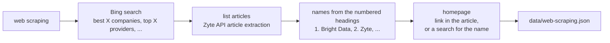

# 02 Find the competitors

Goal: see where the competitor list comes from. Short one, no browser.

The question was "who are our competitors?". We're a web scraping company, so the list is in [`data/web-scraping.json`](../../data/web-scraping.json): 20 companies, each with a homepage and how many list articles mention it. The rest of the workshop starts from this file.

## How it was made



Everything here is plain HTTP requests through Zyte API. No browser, because nothing here needs one: search results and articles come back fine without JavaScript, and an HTTP request is much cheaper and faster than a browser session. The browser comes back in lesson 03, for the competitor sites themselves.

A few things worth knowing:
- **Mentions.** A company named in all 3 articles is more likely a real player than one named once.
- **Directories don't work.** Sites like Clutch or GoodFirms build their lists with JavaScript, so a plain request gets almost nothing. The script skips them.
- **Search is not stable.** Run it twice, get different articles. That's why the list is saved and every later lesson reads the saved copy.

## Run it (optional)

```bash
python lessons/02-find-competitors/discover.py "web scraping"
```

About 30 seconds and a couple dozen Zyte API requests. It writes to `output/02/web-scraping.json`, so the saved list in `data/` stays as it is. Compare the two.

Try another space: `"specialty coffee roasters"`, `"project management software"`. Check the homepages, the further you get from list-article-friendly topics, the more the name search guesses wrong.
