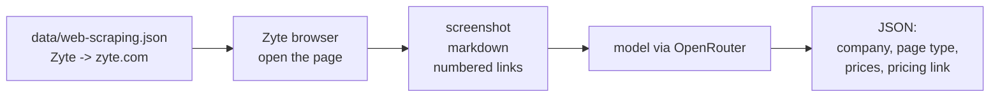

# 03 Describe a page

Goal: open a company's homepage in a Zyte browser, hand what you captured to a model, and get back what the page is.

No coding in this lesson. You run a script and read the output.

## What happens

Animated version, with the numbers from a real run: open [`diagrams/03-describe.html`](../../diagrams/03-describe.html) in your browser and press space.



The browser part is lesson 01 again. The session closes before the model is asked anything: the model never touches the browser, it only sees what your script captured.

The model gets three things in one message:
- the **screenshot**, as an image. Good for layout, pricing cards, banners.
- the **markdown**, the page text. Cheap to read, good for exact numbers.
- the **numbered links**, so it can point at one ("link 76") instead of making up a URL.

It answers in a fixed shape (a JSON schema in `describe.py`): company, a short description, page type, any prices on the page, and which link most likely leads to pricing. A fixed shape is what makes the answer usable by code. Lesson 04 clicks that pricing link.

## Run it

```bash
python lessons/03-describe-a-page/describe.py
```

It opens zyte.com, our own homepage, so you can check the answer against a site you know. Zyte is in the list from lesson 02. Any other name from the list works, or a URL:

```bash
python lessons/03-describe-a-page/describe.py Apify
python lessons/03-describe-a-page/describe.py Oxylabs
python lessons/03-describe-a-page/describe.py https://www.zyte.com/pricing/
```

## What to look at

Every step shows if a browser is running for you: `[browser OPEN]` or `[browser closed]`.

**Connect to close.** The browser opens when you connect, not when you load the page. Then: go to the page, take the screenshot, read the HTML, list the links. Then `Browser.close`. The script prints how long it was open and what that's billed as: one page load, or the number of 15 second blocks, whichever is higher. There's no extra "wait until the page is quiet" step. We tried it: busy sites never go quiet, it added 5 seconds to every session and the result was the same. Every second the browser is open is billed, so wait for what you need and close.

**Closed before the model.** All the capture happens while the browser is open. The model call starts after it's closed. A slow model doesn't keep a browser running.

**The message.** Printed as JSON, with the image replaced by its size: the system prompt, then the image, the page text and the links. Long pages are cut, the script says when.

**Tokens and cost.** Seconds, tokens in, tokens out, dollars. Most tokens in are the page text and the image. Keep that number in mind for lesson 05, where this runs on every page of every competitor.

**The answer.** Exactly the JSON the model sent back, in the shape we asked for. Then what our code does with it: look up the link number in our own list. Is the page type right? Is the pricing link right? On a pricing page, check the prices against `screenshot.jpg`.

**Timeline.** One bar per phase: connect, browser open, model.

Files in `output/03/<site>/`:

| File | What it is |
|---|---|
| `screenshot.jpg` | what the model saw |
| `page.md` | the page text, full length |
| `links.txt` | the numbered links the model picked from |
| `request.json` | the message sent to the model, image left out |
| `answer.json` | the answer, plus model, time, tokens, cost |
| `trace.zip` | the browser session, recorded with Playwright tracing |

## Replay the session

The browser session is recorded with Playwright tracing. Open it with:

```bash
playwright show-trace output/03/zyte.com/trace.zip
```

Or drop the file on [trace.playwright.dev](https://trace.playwright.dev), it stays in your browser. You get a filmstrip of what the browser showed, every action with the page (the DOM) before and after it, the network requests and the console. Click "Go to" and look at the requests: that's everything the page pulled in while loading. None of it went through your laptop.

## Try

- A pricing page: `describe.py https://www.zyte.com/pricing/`. Do the prices come out right? Compare with the screenshot.
- Another model: `--model google/gemini-3.5-flash-lite` or `--model anthropic/claude-sonnet-5`. Same page, compare the answer, the time and the cost. Any model on [openrouter.ai/models](https://openrouter.ai/models) that takes images will work.
- A few companies in a row. Which one breaks it? A cookie wall, a block page, a homepage with no link to pricing?

## Research: what should the model see?

Screenshot + markdown + links is one way to describe a page. Playwright's accessibility snapshot (`page.aria_snapshot(mode="ai")`) is another: roles, names and a ref on everything clickable. We measured five combinations on five real pages: which picks the right click, which reads prices right, what it costs in tokens and in browser seconds. Results, what we learned and the script to re-run it: [`research/`](../../research/).
