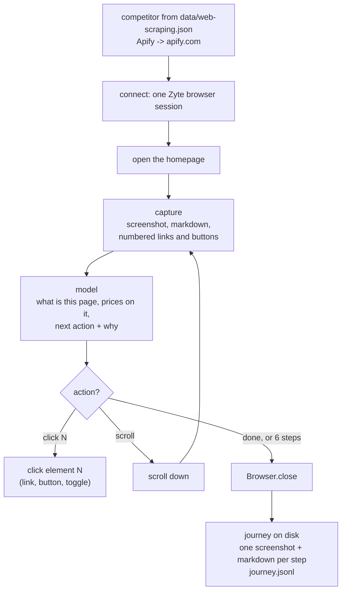
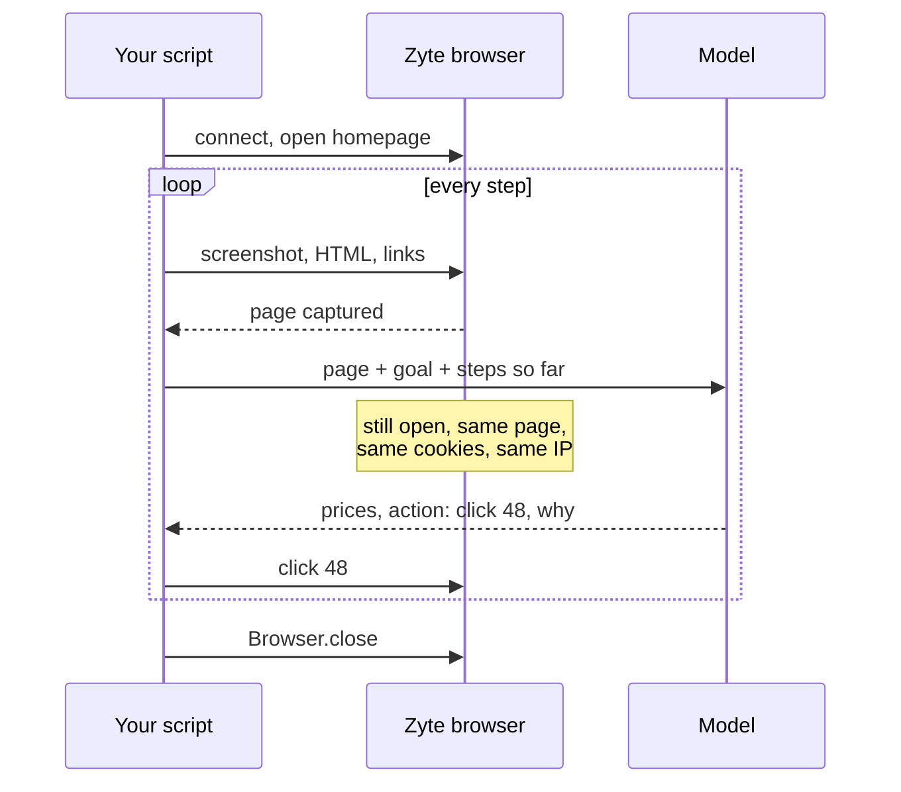

# 04 Agent loop

Goal: let the model drive. It looks at a page, says what it sees, picks the next click, and keeps going in the same browser until it has the competitor's prices.

No coding in this lesson. You run a script and read the output.

## The flow

Animated version, on a real run: open [`diagrams/04-agent-loop.html`](../../diagrams/04-agent-loop.html) in your browser and press space. It walks through a recorded run on zyte.com, with the screenshots the model got: click Pricing, reject the cookie banner that hides the plans, scroll, done. At each step you see what the model answered, what our code did, and where the seconds and dollars went.



It's lesson 03 in a loop. Same capture, same kind of answer, plus one field: what to do next. Our code does the clicking, the model only says which number.

## One browser for the whole run

The browser stays open while the model thinks. That's different from lesson 03, where we closed it before asking.



Why not close it and open a new one every step?

- **State.** A new browser starts from nothing. A "Bill annually" toggle has no URL, so a fresh browser always shows monthly prices. The cookie banner comes back every time. The proxy can change, so the site sees a different visitor every step.
- **Cost.** A session costs whichever is higher: page loads, or 15 second blocks. In a loop, time usually wins: the browser waits while the model thinks, and a toggle or an in-app link doesn't count as a page load. On Apify a run is 1 page load but ~26 seconds, so 2 units, and about 10 of those seconds are the model thinking. A new session per step would be 3 sessions, at least 3 units, plus ~3 seconds to connect each time. So the waiting costs something, reopening costs more, and you lose the state. A faster model is the way to cut the waiting.

The script prints both at the end: what this run cost, and what a new browser per step would have cost.

## Run it

```bash
python lessons/04-agent-loop/agent.py
```

It starts on Apify's homepage with the goal "find the pricing, capture every price set and what each plan includes". A good run: click Pricing, flip the monthly/annual toggle, done.

## What to look at

**Each step.** URL, what the model thinks the page is, prices it sees, and the action with its reason: `click 48 'Pricing'`, `click 'Bill annually'`. If there's a cookie banner in the way, the model can click it away like any other button.

**What each plan includes.** Next to every price the model lists what the plan gets you, in the company's own unit, the way the page says it: "$19 prepaid usage", "$0.2 per compute unit". Apify sells prepaid dollars and compute units, others sell credits, queries or tasks. We don't convert them, there's no honest common unit.

**Steps so far.** Every call gets a short list of what happened before, with the prices already saved: "2. /pricing: clicked 'Bill annually'. Prices saved: Starter 19 USD/month, billed monthly; ...". Without the prices in there the model doesn't trust that it has the monthly set and flips the toggle back to check. With them it stops after 3 steps.

**When a click fails.** Links inside a dropdown menu are on the page but not clickable until the menu opens on hover (Oxylabs, "Explore subscriptions"). The click times out after 5 seconds, and if it's a link, our code opens its URL instead. The model doesn't need to know.

**The cost.** Steps, page loads, seconds the browser was open, units. Tokens and dollars for the model. And the comparison with a new browser per step.

**The timeline.** The browser bar runs the whole way. The model calls sit inside it.

Files in `output/04/<site>/`:

| File | What it is |
|---|---|
| `NN_<page>.jpg` | screenshot at each step |
| `NN_<page>.md` | page text at each step |
| `journey.jsonl` | one line per step: url, page type, prices, action, why, tokens. Lessons 05 and 06 read this |
| `trace.zip` | the whole browser session, recorded with Playwright tracing |

## Replay the session

```bash
playwright show-trace output/04/apify.com/trace.zip
```

Or drop it on [trace.playwright.dev](https://trace.playwright.dev), the file stays in your browser.

Every step is two entries in the trace: "look at the page, ask the model", then the action, named with what the model decided and why: `Step 2: click 54 '-10% Bill annually'. Model: the monthly set is captured, so I'll flip the toggle...`. Click an action to see the page right before it, with the element it clicked. That's the page the model was looking at when it decided.

Look at the gap in the filmstrip during "ask the model": the browser is sitting there, open and billed, waiting for an answer.

## Try

- Oxylabs: `agent.py Oxylabs`. Pricing is under a menu. Does it get there?
- Another goal: `agent.py Zyte --goal "find out if there is a free trial and what it includes"`
- Another model: `--model google/gemini-3.5-flash-lite`. More steps or fewer? Cheaper overall?
- Break it: `--max-steps 2`. What does the journey look like when it runs out?
