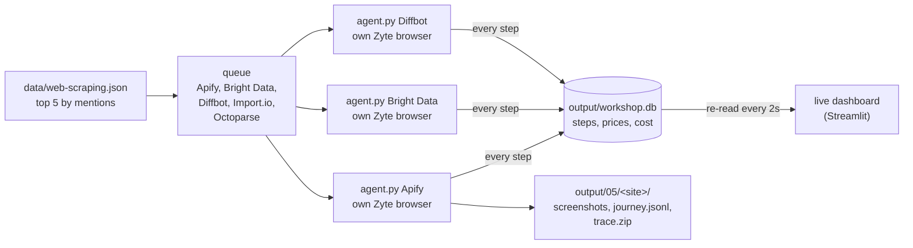

# 05 Explore competitors

Goal: run the agent from lesson 04 on several competitors at once and get everyone's prices in one go.

No coding in this lesson. You run a script and read the output.

## The flow

Animated version, on the recorded run: open [`diagrams/05-explore.html`](../../diagrams/05-explore.html) in your browser and press space.



Three run at the same time. When one finishes, the next one in the queue starts. Every agent writes each step into one small database as it goes, and the dashboard reads it.

Each competitor is lesson 04 as it is: one agent, one browser session, until it has the prices or runs out of steps. `explore.py` only starts them, watches them, and adds up the results.

## One browser per competitor

In lesson 04 we kept one browser for the whole run, because the steps on one site depend on each other: the cookie banner, the toggle, the IP. Different competitors share nothing, so each gets its own session. That's also what lets them run in parallel.

Each agent runs as its own process. If one site crashes or hangs, the others carry on.

## Run it

Two terminals. First the dashboard:

```bash
streamlit run lessons/06-report/app.py
```

It opens in your browser and waits for data. Then the agents:

```bash
python lessons/05-explore-competitors/explore.py
```

The top 5 competitors by mentions in `data/web-scraping.json`, 3 at a time. About a minute.

Pick your own:

```bash
python lessons/05-explore-competitors/explore.py Zyte Oxylabs ScrapingBee
python lessons/05-explore-competitors/explore.py --top 8 --parallel 4
```

## What to look at

**The dashboard, while it runs.** One card per competitor: where it is (waiting, step 2, done), the screenshot of the page it's looking at, and the model's last reason ("flipping the toggle to Bill annually, monthly prices are saved"). Below, the prices table grows as each agent finds prices, and the cost counters go up. It updates every step, not every frame: it's the agent's view, not a video.

**The terminal, while it runs.** One line per competitor with the same status. Watch three of them move at the same time.

**The summary.** One row per competitor:

| Column | What it is |
|---|---|
| status | done, out of steps, or error |
| page status | HTTP status of the pages it opened. Expect 200s, plus the odd 301/302 redirect |
| steps | how many look-and-act steps it took |
| prices | how many prices it found |
| browser | seconds open, units |
| model | tokens and dollars |

Then the totals: competitors, wall time, units, dollars. Compare the wall time with the sum of the browser times: that's what running in parallel saved.

**The odd ones out.** Which competitor took the most steps? Which found no prices? Open its trace and see where it went: a menu it couldn't open, pricing behind "Contact sales", a page with prices in a calculator.

Files in `output/05/`:

| File | What it is |
|---|---|
| `<site>/journey.jsonl` | the journey for one competitor, same as lesson 04 |
| `<site>/NN_<page>.jpg`, `.md` | screenshot and page text at each step |
| `<site>/trace.zip` | the browser session, open with `playwright show-trace` |
| `<site>/agent.log` | everything the agent printed |
| `summary.json` | the table above, as data |
| `../workshop.db` | every step and price of every run, what the dashboard reads. Lesson 06 starts from here |

## No wifi?

Replay a recorded run instead. It plays a saved run into the database with its original timing, so the dashboard fills in exactly as it would live. No Zyte, no OpenRouter, no network:

```bash
python lessons/05-explore-competitors/explore.py --replay
```

The recording is `data/sample-run.db`: steps, reasons, prices, what each plan includes and costs from a real run. No screenshots, those are pictures of other people's sites, so the cards show the page name instead.

No Python either? Open `deck/replay.html` in your browser. It plays the same recording with its real timing: one card per agent, and the plans filling in as they're found. It's also a slide in the deck. After re-recording (`explore.py --save-sample`), refresh it with `python deck/export_run.py`.

## Try

- Your own list: three companies you know, see if the prices match what you'd expect.
- `--parallel 1`, then `--parallel 5`. How does the wall time change? Does the cost change?
- A cheaper or faster model: `--model google/gemini-3.5-flash-lite`. Fewer steps or more? Same prices?
