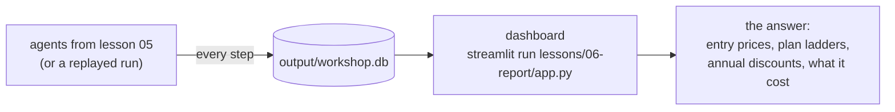

# 06 Report

Goal: answer the boss. Who are our competitors, what do they charge, and what do you get for it?

No coding in this lesson. You open the dashboard and read it.

## Where the data comes from



You already watched the database fill up in lesson 05. Every price in it came from one step of one agent, on one page, with the model's reason for being there. Nothing is typed in by hand.

The agent writes prices in two forms:
- **as shown:** "19", "month + pay as you go, billed annually", "from 2,500", "custom"
- **comparable:** price in USD per month as a number, monthly or annual billing, and the kind of price (subscription, usage, custom)

And for each plan, **what it includes**: "$19 prepaid usage", "250,000 credits / month", "100 tasks". In the company's own units, as the page says it.

The second form is what makes the charts possible. "$17/month billed annually" and "$0.13 per compute unit" are both prices, but only one of them is a plan you can put on a bar chart.

## Run it

If it's not open from lesson 05:

```bash
streamlit run lessons/06-report/app.py
```

Nothing ran on your laptop? Fill the database from the recorded run first:

```bash
python lessons/05-explore-competitors/explore.py --replay --fast
```

## What to look at

**Entry price.** The cheapest paid plan per competitor, per month. Who's the cheap way in?

**Plan ladder.** Every plan of every competitor as a point. Who stops at a few hundred a month, who goes straight to "talk to sales"?

**Annual discount.** Plans that show both monthly and annual prices, and the difference. That's the toggle from lesson 04 paying off: without the click, half of these numbers wouldn't exist.

**What each plan includes.** One row per plan: its prices and what it gets you. Apify sells prepaid dollars and compute units, Diffbot credits, Import.io queries, Octoparse tasks. There's no common "price per request" across them, so you compare what each plan gets you. The same view as a slide: `deck/replay.html?view=plans`.

**The table.** Every price with its competitor, plan, both forms, and the page it came from. Check a few against the screenshots in `output/05/<site>/`. The model reads prices well, but it's the step you'd verify before sending this to your boss.

**What the research cost.** Browser units, model dollars and minutes per competitor. Compare with doing it by hand.

## Run it again next week

Every run adds to the same database, it doesn't replace anything. Run lesson 05 once a week and the dashboard turns into price history: who changed a plan, who added a tier, who dropped a free plan. That's the difference between a one-off research task and monitoring.

## Try

- Run lesson 05 again on two more competitors, then refresh the dashboard. The new ones show up next to the old ones.
- Pick the run in the sidebar and compare two runs of the same competitor. Same prices? Same path through the site?
- Open `output/workshop.db` with any SQLite tool (`sqlite3 output/workshop.db`, DB Browser, your IDE). It's three tables, nothing hidden.
